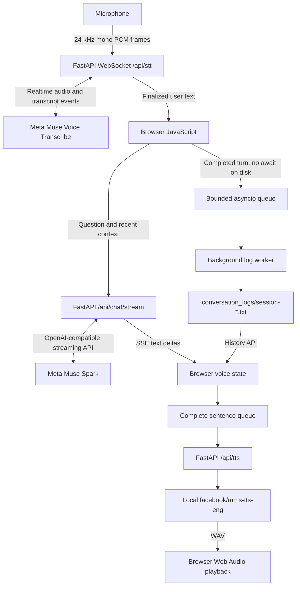
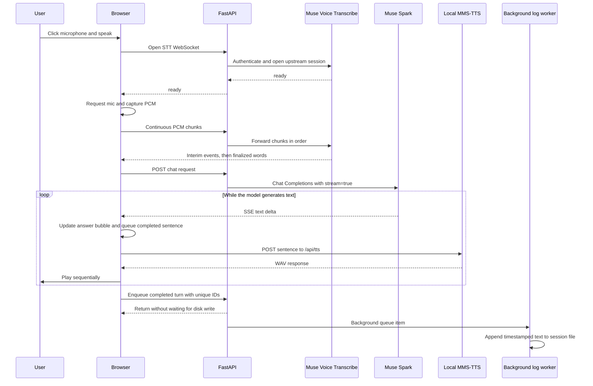

# 🎙️ Voice-Pilot, Explained

> **Architecture at a glance:** browser audio → Meta transcription → streamed Muse Spark response → local MMS voice.

This guide describes the code that is in the repository. Voice-Pilot uses a
browser for the microphone, chat, face, and playback; FastAPI connects that
browser to Meta's hosted STT/chat services and the local Python TTS model.

## 1. 🎯 What Voice-Pilot does

Voice-Pilot lets you ask questions aloud and hear the response. The app turns
speech into text, asks Muse Spark for an answer, displays that answer as a
compact chat bubble while it is generated, and speaks it using MMS-TTS. User
and assistant messages are stored as private local text logs.

## 2. 🧩 Architecture





## 3. 🔄 Complete request flow

1. A microphone click resumes the browser playback context and opens
   `/api/stt` as a WebSocket.
2. The browser sends a `start` control message and waits for the backend's
   upstream Meta `ready` event before it asks for microphone permission and
   starts sending audio. This avoids starting capture while the upstream
   recognition connection is still being established.
3. Browser Web Audio captures mono 24 kHz samples and converts them to signed
   16-bit little-endian PCM. Small chunks are relayed through FastAPI to Meta.
4. Meta sends interim events and finalized speech. Interim fragments are used
   internally and are not displayed. A finalized user turn appears once in a
   chat bubble and enters the response queue.
5. FastAPI sends the question and recent context to Muse Spark. Model deltas
   arrive as SSE; JavaScript incrementally updates an assistant chat bubble.
6. Completed sentences enter a serial TTS queue. The browser stops sending
   microphone frames while a response is in progress, then calls `/api/tts`;
   local MMS inference returns WAV audio. Web Audio decodes and plays one clip
   at a time, keeping text streaming independent of synthesis and preventing
   assistant audio from becoming the next user turn.
7. After a complete model response, the browser sends a turn ID, session ID,
   finalized user text, and assistant text to the local history endpoint. The
   backend queues the record and immediately returns; a worker writes it to
   disk independently.

## 4. 🌐 FastAPI and the browser

`app/main.py` starts the conversation-log worker with the FastAPI lifespan and
exposes:

| Route | Purpose |
|---|---|
| `GET /api/health` | Backend liveness |
| `WS /api/stt` | Relays continuous PCM and Meta transcript events |
| `POST /api/chat/stream` | Streams Muse Spark response as SSE |
| `POST /api/tts` | Returns local speech synthesis as WAV |
| `GET /api/history` | Lists completed local turns |
| `POST /api/history/turn` | Enqueues one idempotent turn for persistence |
| `DELETE /api/history` | Clears saved session text files |

`static/index.html` contains the responsive voice UI and animated SVG face.
`static/styles.css` defines gradients, state animations, and reduced-motion
behavior. `static/app.js` handles the microphone, STT connection state, SSE
parsing, response/TTS queues, playback, and background history persistence.

## 5. 🎤 Streaming speech recognition

The browser sends mono 24 kHz PCM frames to FastAPI over `/api/stt`. FastAPI
connects to `wss://api.meta.ai/v1/asr/realtime` using the server-side
`MODEL_API_KEY`, then forwards audio and recognition events. The app uses
Meta's realtime endpointing and cumulative partial-transcript mode; this is
live recognition, not a recording uploaded after the user stops.

At startup JavaScript waits for a provider-ready event (with a timeout) before
starting microphone capture. Server configuration and provider error events
are surfaced to the UI. Raw audio and interim transcript fragments are not
written to history files.

## 6. 💬 Muse Spark text streaming

The browser sends finalized user text and bounded recent context to
`POST /api/chat/stream`. FastAPI calls
`https://api.meta.ai/v1/chat/completions` with the configured model
(`muse-spark-1.3` by default) and `stream=true`. The model's incremental text
is forwarded as SSE deltas. The browser inserts text into the current
assistant bubble as deltas arrive; a final event marks completion. Errors,
timeouts, and dropped streams do not trigger an automatic retry that could
duplicate a partial answer.

The authorization header is constructed on the backend. Neither API
credentials nor authorization headers are sent to JavaScript or logged.

## 7. 🔊 MMS-TTS and browser playback

`app/tts.py` lazily loads `facebook/mms-tts-eng` from the Hugging Face cache.
FastAPI's synchronous `/api/tts` handler runs outside the async chat/STT event
loop. It synthesizes each sentence to a temporary WAV and removes the server
temporary file after sending it. The model is reused after its first load.

The browser decodes WAV bytes with Web Audio. A single promise queue preserves
sentence order and prevents overlapping speech. The speaking state and mouth
animation follow playback timing approximately; they are not phoneme or
waveform synchronized. Playback fades reduce clip-edge clicks.

## 8. 🙂 Face states

JavaScript sets the SVG face's `data-state` as the app moves through idle,
listening, thinking, speaking, success, and error. Two appearances both as Raala are selectable via `data-face`. CSS changes the halo,
outline color, microphone ring, and mouth expression for those states. The
face uses only inline SVG, CSS, and small CSS keyframe animations; the
`prefers-reduced-motion` media query disables continuous motion for users who
request it. Broad response keywords can also choose a visual mood color; that
heuristic does not affect the synthesized voice.

## 9. 📝 Background conversation logging

The browser creates one random session UUID per tab and one random turn UUID
per finalized question. Once Muse Spark returns a complete answer, JavaScript
posts the pair to `/api/history/turn` without awaiting that request in the
speech pipeline.

`ConversationLogWorker` uses a bounded `asyncio.Queue` and one asynchronous
worker. The worker delegates filesystem work to `asyncio.to_thread`, so file
creation and append operations do not run on the event loop that handles
speech and streamed chat. Turns are processed in queue order. Session UUIDs
determine safe filenames; turn IDs are tracked in memory and loaded from
existing files at startup so a retried request is not written twice.

Each UTF-8 `.txt` file contains a session ID and readable timestamped user and
assistant messages. The files are stored under the repository's ignored
`conversation_logs/` directory. They contain no interim recognition text, raw
audio, API keys, or tokens. Disk errors are logged without exposing
conversation text and do not stop the queue or voice APIs. The Clear History
endpoint places a clear operation in the same queue, so earlier writes finish
before saved files are removed.

## 10. 🗃️ Files and folders

| Path | Purpose |
|---|---|
| `app/main.py` | FastAPI routes, Meta STT/chat relays, TTS, history APIs |
| `app/conversation_logs.py` | Bounded async writer, deduplication, history/clear |
| `app/tts.py` | Lazy MMS and optional Pocket TTS inference |
| `static/index.html` | Voice interface, SVG face, chat history |
| `static/styles.css` | Responsive gradients, bubbles, animations |
| `static/app.js` | Microphone, streaming chat, state, logging API, playback |
| `tests/test_chat_stream.py` | STT, chat, TTS and history endpoint tests |
| `tests/test_conversation_logs.py` | Queue ordering, deduplication, clear and errors |
| `requirements.txt` | Python dependency pins |
| `.env.example` | Placeholder environment-variable template |
| `.gitignore` | Excludes credentials, logs, generated audio and caches |
| `conversation_logs/` | Generated private `.txt` history; ignored by Git |

## 11. 🔐 Environment variables and credentials

Copy `.env.example` to `.env` in the project root and set:

```text
MODEL_API_KEY=your_meta_model_api_key
```

The optional `MUSE_CHAT_MODEL` defaults to `muse-spark-1.3`. `load_dotenv()`
loads local configuration when Python starts; restart the server after
editing `.env`. Never paste a real key into `static/`, documentation, logs, or
a commit. `.env` is ignored; only the placeholder `.env.example` belongs in
Git.

## 12. ⚡ Concurrency and the deadlock fix

Muse Spark uses asynchronous HTTP streaming, so FastAPI can forward text while
the upstream model is generating. TTS is a synchronous route, which FastAPI
runs in its worker pool. In `app/tts.py`, a re-entrant thread lock protects
lazy model loading and inference. The loader can be called while synthesis
already holds the lock; a regular non-reentrant lock would deadlock at that
nested acquisition. Keep the existing re-entrant lock.

The browser queues TTS sentences serially. The file logger has its own bounded
queue and background worker; logging is not awaited before TTS starts or while
the response streams. If disk logging fails, voice interaction continues.
Stop/interrupt actions abort active browser fetches and audio; an already
running local inference can finish on the server after its browser request is
canceled.

## 13. 🛠️ Install, run, test, and troubleshoot

From the project root in PowerShell:

```powershell
py -3.12 -m venv .venv
.\.venv\Scripts\Activate.ps1
python -m pip install -r requirements.txt
if (-not (Test-Path .env)) { Copy-Item .env.example .env }
notepad .env
python -m uvicorn app.main:app --host 127.0.0.1 --port 8002
```

Open `http://127.0.0.1:8002` and allow microphone access. In a second
PowerShell window:

```powershell
Set-Location C:\Users\shant\Projects\callpilot
.\.venv\Scripts\Activate.ps1
python -m unittest discover -s tests -v
Invoke-RestMethod http://127.0.0.1:8002/api/health
```

Troubleshooting:

- **Microphone denied:** grant site permission in Chrome/Edge and use localhost
  or HTTPS. The app waits for upstream STT readiness before capture.
- **STT configuration/provider error:** check `.env`, Meta service access, and
  the backend process that is actually serving the page. Restart it after
  changing the key. Do not display or share the key.
- **Muse Spark error:** check model access and network reachability; the API
  error or timeout is reported in the UI/server output.
- **Silent playback:** allow browser/site audio, check the selected output and
  volume, and click the microphone again to resume the audio context. Test
  `/api/tts` to separate synthesis errors from browser playback.
- **Slow first answer:** MMS model weights may be downloading or initializing.
  CPU inference is slower; check CUDA compatibility and GPU memory if using an
  NVIDIA GPU.
- **History write warning:** verify that the project directory is writable.
  Existing speech continues; inspect the server log without sharing private
  conversation files.

## 14. ⚖️ Limitations and licensing

Speech recognition and Muse Spark require Meta connectivity; audio and
recognized questions are transmitted to the provider. TTS runs locally after
the initial model download. Spoken output is sentence-by-sentence rather than
model-native audio streaming. Local conversation logs persist until cleared
and should be treated as private data.

Review Meta Model API terms, the MMS model card/license, and any optional
model's license before redistribution or commercial use. This repository does
not grant rights to the external APIs or model weights.
