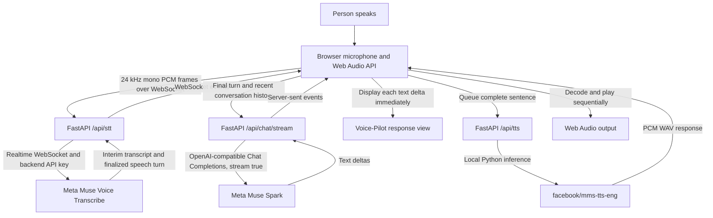

# Voice-Pilot, Explained

This guide walks through the implementation in beginner-friendly language. The
backend and browser exchange live microphone audio, streamed text, and WAV
audio; Meta STT and Muse Spark are hosted APIs, while MMS text-to-speech runs
locally in Python.

## 1. What Voice-Pilot does

Voice-Pilot lets you ask questions out loud and hear spoken answers. It solves
the basic voice-assistant loop:

1. Capture what a person says.
2. Turn the speech into text.
3. Generate an answer using a conversational model.
4. Turn the answer text into speech and play it.

The browser shows partial transcripts and the assistant's streamed answer as
they arrive. The assistant speaks complete sentences in order; it does not
stream synthesized audio token by token.

## 2. High-level architecture



## 3. Complete microphone-to-playback flow

1. Press the microphone button. That browser gesture also resumes the audio
   playback context so later speech is less likely to be blocked by autoplay
   rules.
2. The browser asks for microphone permission and creates a 24 kHz audio
   capture context. It converts mono floating-point samples to signed 16-bit
   little-endian PCM.
3. Small audio frames are sent over a WebSocket to FastAPI's `/api/stt` route.
   FastAPI connects to Meta's realtime speech API and forwards audio in order.
4. Meta sends interim transcript events while the person is speaking, then a
   final `speechComplete` event for a speech turn. Interim text is shown as a
   temporary view; only finalized text is sent as the question.
5. The browser posts the question and recent completed turns to
   `/api/chat/stream`. Muse Spark returns incremental text deltas. The browser
   appends each delta to the visible response immediately.
6. As the streamed text reaches sentence boundaries, those sentences enter a
   serial speech queue. Text rendering continues while MMS works on audio.
7. For each sentence, the browser requests `/api/tts`. FastAPI runs MMS-TTS
   locally, returns a WAV file, and removes its temporary server-side file
   after the response is delivered.
8. The browser checks that the response is WAV, decodes it with the separate
   Web Audio playback context, and plays one sentence at a time. It does not
   start a second audio source over the current sentence.
9. A stop request or detected speech interruption aborts the browser's active
   Muse request, stops current playback, and discards queued audio. A completed
   text answer is retained in history even if its speech playback is stopped.

## 4. FastAPI and the frontend

FastAPI is the Python web server. `app/main.py` serves the static page and
provides four main interfaces:

- `GET /api/health`: a small backend reachability check.
- `POST /api/tts`: accepts text and a voice model name; returns WAV audio.
- `POST /api/chat/stream`: accepts conversation messages and streams SSE events.
- `WS /api/stt`: receives browser audio and relays Meta transcript events.

The frontend is plain HTML, CSS, and JavaScript in `static/`. The HTML defines
the interface and inline SVG face; CSS draws its visual states and animations;
JavaScript manages microphone capture, transcripts, SSE rendering, the
sentence queue, cancellation, and playback. No frontend framework or API key
is used.

## 5. How live STT works here

The browser's `getUserMedia` obtains microphone audio. A Web Audio
`ScriptProcessorNode` currently reads 2,048-sample blocks and converts each
sample to 16-bit PCM. Those binary frames go to `/api/stt` over WebSocket.

FastAPI validates frame sizes and limits each listening session to ten minutes,
then relays frames to `wss://api.meta.ai/v1/asr/realtime` with the selected
model (`muse-voice-transcribe-1.0`) and the backend `MODEL_API_KEY`. Meta
supports realtime streaming and interim results. The backend forwards provider
events to the browser. The browser replaces the visible interim text as it
changes, then appends the finalized `speechComplete` text once, avoiding
duplicate words.

The browser keeps the microphone active across turns. Use the same microphone
button to stop; the backend sends `endStream` and forwards the provider's final
events before closing the session.

## 6. How Muse Spark and text streaming work

The browser submits the finalized question and recent user/assistant turns to
`POST /api/chat/stream`. The browser does not send credentials. FastAPI reads
`MODEL_API_KEY` from its environment and calls
`https://api.meta.ai/v1/chat/completions` with `model=muse-spark-1.3` and
`stream=true`.

Meta's OpenAI-compatible response contains server-sent event records. FastAPI
parses each record and forwards text as its own SSE `delta` event. Empty
choices and chunks without content are ignored; provider errors, timeouts,
empty results, and unexpectedly terminated streams are reported to the page.
The final `done` event marks a completed response. The browser uses
`ReadableStream.getReader()` to parse SSE frames as they arrive, updates the
response panel, and stores the complete successful answer for the next turn.
History is held only in the current page and bounded before each request.

If a request fails partway through, already-rendered text stays visible, but an
incomplete assistant answer is not added as a completed history turn. The app
does not retry that request automatically.

## 7. How MMS-TTS creates speech

`app/tts.py` uses the Hugging Face model `facebook/mms-tts-eng` through
Transformers. The model and tokenizer load only on the first synthesis request.
The model returns a waveform, which SoundFile writes as a PCM-16 WAV. Sentence
pauses are added for the standalone multi-sentence endpoint; conversational
sentences are requested separately so playback can begin while later text is
still being generated.

The main browser voice uses MMS English. `/api/tts` retains the optional
`pocket-indian` voice option, but using it requires installing `pocket-tts` and
fetching its voice checkpoint. It is not needed by the main interface.

## 8. Browser audio playback

There are two distinct Web Audio contexts:

- A 24 kHz context captures microphone PCM in the format expected by Meta STT.
- A playback context resumes from the microphone button's user gesture, decodes
  the WAV response, and plays the resulting audio buffer through the browser's
  output device.

The UI validates the HTTP status, `audio/wav` content type, WAV payload size,
and browser decoding. A serial promise queue prevents overlapping sentences.
The animated face enters its speaking state while an audio buffer plays. This
is approximate timing, not lip synchronization. If sound is blocked, the page
shows an audio error while keeping the streamed text available.

## 9. Important files and directories

| Path | Purpose |
|---|---|
| `app/main.py` | FastAPI app, STT relay, Muse Spark SSE, health and TTS routes |
| `app/tts.py` | Lazy local MMS/Pocket model loading and WAV synthesis |
| `static/index.html` | Compact Voice-Pilot UI and original SVG face |
| `static/styles.css` | Responsive light theme and avatar state animations |
| `static/app.js` | Microphone, transcript, chat stream, sentence queue, playback |
| `tests/test_chat_stream.py` | Streaming, errors, timeouts, cancellation tests |
| `requirements.txt` | Pinned Python runtime and MMS-TTS dependencies |
| `.env.example` | Placeholder configuration; safe to commit |
| `.gitignore` | Excludes `.env`, model/audio outputs, caches, virtualenv and IDE files |
| `artifacts/` | Local generated samples; audio is ignored by Git |

## 10. Configuration and secrets

Copy `.env.example` to `.env` in the project root and set:

```text
MODEL_API_KEY=your_meta_model_api_key
```

Optionally set `MUSE_CHAT_MODEL=muse-spark-1.3`. The server loads `.env` at
startup; restart the server after changing configuration. `.env` is ignored by
Git. Never put keys in `static/`, documentation, command output to be shared,
or a committed file. The browser only connects to the local Voice-Pilot server.

Model weights are not stored in the repository. Transformers uses the local
Hugging Face cache after downloading `facebook/mms-tts-eng`; hosted Meta models
are reached through the API.

## 11. Concurrency and the earlier deadlock

The Muse Spark client is asynchronous and relays text while it is being
generated. The synchronous `/api/tts` route runs through FastAPI's worker pool,
so a slow first model load does not block the event loop handling the SSE
stream.

`app/tts.py` protects model loading and inference with a `threading.RLock`.
Initialization calls the lazy loader while synthesis already holds that same
lock. A normal non-reentrant `Lock` would deadlock when the same thread tried
to acquire it twice; an `RLock` allows this nested acquisition while still
serializing access to the model.

On the browser, speech generation is a single serial queue. Stop or voice
interruption aborts active browser fetches and audio, and advances a generation
identifier so stale queued sentences are skipped. An already-running
synchronous Python inference may finish after the browser has canceled its
request.

## 12. Run, test, and troubleshoot

From the project root in PowerShell:

```powershell
.\.venv\Scripts\Activate.ps1
python -m uvicorn app.main:app --host 127.0.0.1 --port 8000 --reload
```

Open `http://127.0.0.1:8000`, allow microphone access, and click the large
microphone. Speak a short sentence, pause, then wait for the text and audio.
Use **Stop response** or speak while the assistant is talking to interrupt it.

Run tests in a second PowerShell window, also from the project root:

```powershell
.\.venv\Scripts\Activate.ps1
python -m unittest discover -s tests -v
Invoke-RestMethod http://127.0.0.1:8000/api/health
```

Common problems:

- **Microphone denied:** allow the site's microphone permission in the browser,
  then reload. Use localhost or HTTPS.
- **STT fails:** make sure `.env` is in the repository root, the key is
  non-empty, the account has Muse Voice Transcribe enabled, and Uvicorn was
  restarted after editing `.env`. Check the Uvicorn window; never print the key.
- **Spark fails:** confirm the key has Muse Spark access and the machine can
  reach Meta Model API. The page shows HTTP/provider errors. The model text
  stream requires network access.
- **No sound:** check system output selection and volume, then click the
  microphone button again to resume browser audio. Call `/api/tts` directly to
  distinguish a backend/model issue from a browser output issue.
- **Slow first spoken answer:** MMS model weights may be downloading and the
  model may be initializing. Check the Hugging Face cache and disk space.
- **CUDA unavailable or out of memory:** verify `torch.cuda.is_available()`,
  install a PyTorch build for the installed driver, close GPU-heavy software,
  or use CPU inference (slower).
- **Old server shows missing-key errors:** stop that Uvicorn process and start
  the backend from this project directory so it loads the current `.env`.

## 13. Limitations and future improvements

- STT and Muse Spark are hosted; microphone audio and recognized text are
  transmitted to Meta. Review the API provider's privacy and retention terms.
- TTS audio generation is local after model download, but its first run needs
  internet access to obtain the weights.
- Audio is synthesized by sentence, so it starts after a sentence is complete
  and the local model has produced its WAV. It is not model-native streaming
  audio.
- `ScriptProcessorNode` is broadly compatible but deprecated in favor of
  `AudioWorklet`; replacing it is a possible future improvement.
- The face animation reflects coarse app/audio state only, not the waveform or
  spoken phonemes.
- Conversation history is not persisted between page loads.
- Review Meta Model API terms and the model-card license for MMS-TTS (and
  Pocket TTS if used) before deployment, commercial use, or redistribution.
