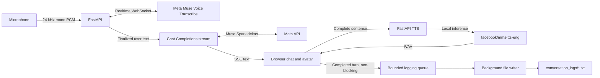

# 🎙️ Voice-Pilot

[](README.md)
[](requirements.txt)
[](app/main.py)
[](docs/00-documentation-index.md)

> **Raala speaks. You listen.** A local-first voice assistant with a colorful animated interface, realtime transcription, streaming answers, and local speech synthesis.

Voice-Pilot is a local-first voice assistant for Windows. Speak into your
browser, follow the assistant's reply as it streams into a compact chat, and
hear each completed sentence spoken by a locally hosted MMS-TTS model.

## 🧭 Table of contents

- [Features](#features)
- [Architecture](#architecture)
- [Requirements](#requirements)
- [Install on Windows](#install-on-windows)
- [Configure Meta API access](#configure-meta-api-access)
- [Models and first launch](#models-and-first-launch)
- [Run Voice-Pilot](#run-voice-pilot)
- [Conversation history and privacy](#conversation-history-and-privacy)
- [Test the services](#test-the-services)
- [Troubleshooting](#troubleshooting)
- [Project history](#project-history)
- [Licensing](#licensing)
- [📚 Technical documentation](docs/00-documentation-index.md)

> **📚 Technical documentation:** Read the [source-verified knowledge base](docs/00-documentation-index.md) for architecture, API contracts, audio flow, lifecycle, testing, security, and extension guidance.

## ✨ Features

- Realtime microphone transcription through Meta Muse Voice Transcribe.
- Progressive Muse Spark text generation over server-sent events.
- Local `facebook/mms-tts-eng` speech synthesis with sequential WAV playback.
- Two selectable faces — both as Raala — with idle, listening, thinking, speaking,
  success, and error states.
- A focused voice interface without an on-screen chat transcript.
- Completed turns saved as readable text files by a background writer, without
  waiting on disk I/O in the STT, chat, or TTS path.
- Unique session files and turn IDs prevent duplicate log entries.
- Reduced-motion support and responsive desktop/mobile layout.
- Stop and voice-interruption controls. API credentials remain on the backend.

## 🧩 Architecture



Speech recognition and Muse Spark need internet access. Speech synthesis runs
locally after the model is downloaded.

## 🛠️ Requirements

- Windows 10/11, PowerShell, Git, and Python 3.12 (64-bit).
- A current Chrome or Edge browser. `localhost` and `127.0.0.1` are secure
  contexts for local microphone access.
- A Meta Model API key with access to Muse Voice Transcribe and Muse Spark.
- Internet access for the Meta APIs and the initial Hugging Face model
  download.
- Optional NVIDIA GPU and matching CUDA-enabled PyTorch. CPU inference works
  but may be slower.

## 🚀 Install on Windows

Run the clone command from any directory. Run the remaining commands from the
new repository root in PowerShell:

```powershell
git clone https://github.com/shantan1213/voice-pilot.git
Set-Location .\voice-pilot
py -3.12 -m venv .venv
.\.venv\Scripts\Activate.ps1
python -m pip install --upgrade pip
python -m pip install -r requirements.txt
```

For an NVIDIA GPU, choose a PyTorch CUDA wheel supported by your installed
driver using the [official PyTorch selector](https://pytorch.org/get-started/locally/).
Install that wheel in `.venv` before installing the remaining requirements.
For CPU-only setup, use the commands above as-is.

If PowerShell blocks activation, allow it only in the current window:

```powershell
Set-ExecutionPolicy -Scope Process -ExecutionPolicy Bypass
.\.venv\Scripts\Activate.ps1
```

## 🔐 Configure Meta API access

From the repository root, create a private `.env` only if one does not already
exist, then edit it:

```powershell
if (-not (Test-Path .env)) { Copy-Item .env.example .env }
notepad .env
```

Add your key:

```text
MODEL_API_KEY=your_meta_model_api_key
```

The optional chat model defaults to `muse-spark-1.3`:

```text
MUSE_CHAT_MODEL=muse-spark-1.3
```

Restart the backend after changing `.env`. The key is used only by FastAPI and
is never sent to frontend JavaScript or written to conversation logs. `.env`
is ignored by Git; `.env.example` contains placeholders only.

## 🧠 Models and first launch

The default voice uses the Hugging Face checkpoint `facebook/mms-tts-eng`.
Transformers downloads and lazily initializes the model on the first TTS
request, then reuses it. The model weights are cached outside the repository.

Muse Voice Transcribe (`muse-voice-transcribe-1.0`) and Muse Spark
(`muse-spark-1.3`) are hosted Meta services, not local downloads.

## ▶️ Run Voice-Pilot

From the repository root:

```powershell
.\.venv\Scripts\Activate.ps1
python -m uvicorn app.main:app --host 127.0.0.1 --port 8002
```

### ⚡ One-command Windows startup

After cloning, install or update `MODEL_API_KEY` in `.env`, then run:

```powershell
Set-ExecutionPolicy -Scope Process -ExecutionPolicy Bypass
.\start.ps1
```

The script creates `.venv` if needed, installs the pinned dependencies, updates
the configured chat model, runs the existing test suite, starts the backend on
port 8002, waits for startup model initialization, and checks the health,
homepage, and frontend bundle endpoints. It writes runtime logs to
`runtime_logs/`, which are excluded from Git. Use `-SkipTests` only when a
faster restart is required.

Open [http://127.0.0.1:8002](http://127.0.0.1:8002), allow microphone access,
and press the microphone button. The status shows Listening, Thinking, and
Speaking while the answer is synthesized sentence by sentence. Microphone
capture is muted while Voice-Pilot speaks so its voice cannot be recognized as
your next request. Press **Stop response** to stop playback, then speak again.
Press the microphone again to end listening and finalize the last utterance.

The app now waits for Meta's STT `ready` event before it asks the browser to
start microphone capture. If the backend lacks a key or the upstream service
rejects the connection, the actual server error is shown instead of a generic
startup-race message.

## 🗂️ Conversation history and privacy

Each completed model-response turn is sent to a bounded in-process queue.
One background worker writes turns in order to a unique session file under
`conversation_logs/`. Each record includes a timestamp, user text, assistant
text, and a unique turn ID. Repeated turn IDs are ignored, including after a
server restart. Interim STT text, raw audio, API keys, and tokens are never
logged.

The backend clears saved conversation logs when it starts, so every server run
begins with a fresh history. During a run, the browser sends at most the five
most recent completed turns to Muse Spark. Generated logs remain private to
this machine and are ignored by Git.

Voice-Pilot sends microphone audio to Meta for transcription and conversation
text to Muse Spark. Review your provider account's data retention and privacy
terms before use.

## 🧪 Test the services

From the repository root:

```powershell
.\.venv\Scripts\Activate.ps1
python -m unittest discover -s tests -v
Invoke-RestMethod http://127.0.0.1:8002/api/health
```

Use the browser for the full microphone → STT → Muse Spark → MMS-TTS
interaction. To check local TTS and get a temporary WAV:

```powershell
$wav = Join-Path $env:TEMP ("voice-pilot-test-" + [guid]::NewGuid() + ".wav")
$body = @{ text = "Hello, this is Voice-Pilot speaking."; model = "mms" } | ConvertTo-Json
Invoke-WebRequest -Uri http://127.0.0.1:8002/api/tts -Method Post `
  -ContentType "application/json" -Body $body -OutFile $wav
Write-Output "WAV written to $wav"
```

To check the Muse Spark text stream separately:

```powershell
$body = '{"messages":[{"role":"user","content":"Reply with one friendly greeting."}]}'
curl.exe -N http://127.0.0.1:8002/api/chat/stream `
  -H "Content-Type: application/json" -d $body
```

The endpoint returns SSE `delta` events followed by `done` when generation
completes. This test exercises text streaming, not browser audio playback.

## 🩺 Troubleshooting

### 🎤 Microphone does not start

- Use Chrome/Edge at `http://127.0.0.1:8002` and allow microphone access.
- Check that the selected port is serving the current project/backend. An
  older Uvicorn process may have a different `.env` loaded. Stop only that
  identified process, restart from the repository root, and refresh the page.
- Confirm `.env` contains a non-empty `MODEL_API_KEY` and restart the backend.
  Never paste the key into a browser or shared log.
- The account/key needs access to `wss://api.meta.ai/v1/asr/realtime`. The app
  displays the backend's configuration or provider error if its connection
  fails.

### 💬 Muse Spark does not answer

- Check `MODEL_API_KEY`, the configured model, network access to
  `https://api.meta.ai/v1/chat/completions`, and account model access.
- Read the Uvicorn output for status and error type. Do not log or share
  authorization headers.

### 🔊 No audible speech

- Allow site audio, check system volume/output device, and press the microphone
  control again to resume the browser audio context.
- Confirm the TTS endpoint returns `audio/wav` using the PowerShell test above.
- First-use delays can come from downloading or loading MMS weights. CPU
  inference is slower. Check available disk and GPU memory.

### ⚙️ CUDA or model download problems

- Confirm CUDA availability with:

  ```powershell
  python -c "import torch; print(torch.__version__); print('CUDA available:', torch.cuda.is_available())"
  ```

- Install a PyTorch build compatible with the local NVIDIA driver, or use CPU
  inference. Close GPU-heavy applications if memory is low.
- Check Hugging Face connectivity and disk space for the model cache.

### 📝 Conversation logs are not appearing

- Completed turns are queued asynchronously. Check the server output for a
  filesystem warning, confirm the repository folder is writable, and inspect
  `conversation_logs/`.
- A full queue returns a clear error while leaving STT/chat/TTS available.
  Generated log files are private runtime data and must not be committed.

## 🕰️ Project history

Built from `git log` history (16 commits on `master`, oldest to newest).
Regenerate with:

```powershell
git log --oneline --decorate
```

Early work finalized streaming voice assistance, then improved spoken
responses and the avatar. The UI was redesigned around background history.
Later work focused the interface on voice, prevented TTS feedback, and
stabilized consecutive turns. Recent work reset history on startup, fixed
the default port to 8002, kept STT ready between turns, improved startup
latency, added one-command Windows startup, and removed Pocket TTS to
leave streamlined MMS voice interactions.

Commits (newest first):

- `3daa5ca` Remove Pocket TTS support and streamline MMS voice interactions
- `410980c` Add one-command Windows startup workflow
- `6cda406` Improve voice response reliability and startup latency
- `512ee31` Keep STT ready between voice turns
- `cc4b159` Use port 8002 as default local app port
- `a2cd7ab` Reset history on startup and limit context
- `9a175d6` Restore fast multi-turn voice lifecycle
- `289d632` Prevent STT restart race between voice turns
- `47cb8bb` Keep selected voice status accurate
- `d29e289` Stabilize consecutive voice turn lifecycle
- `eb8914f` Fix Pocket voice playback handler scope
- `73d8178` Add streaming Pocket TTS comparison mode
- `e03b81b` Focus interface on voice and prevent TTS feedback
- `b3e7c68` Redesign Voice-Pilot UI and add background history
- `b7328bd` Improve Voice-Pilot spoken responses and avatar
- `50bd7c7` Finalize Voice-Pilot streaming voice assistant (initial commit)

## ⚖️ Licensing

This repository does not grant rights to the Meta APIs or model weights. Review
Meta Model API terms, the MMS model card/license, and any optional model's
license before deploying, redistributing, or using Voice-Pilot commercially.
