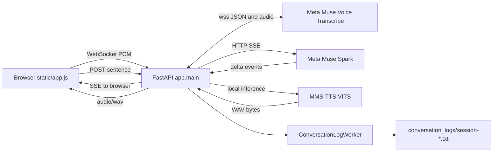

# 🧩 System architecture

The running app is a FastAPI process plus one static browser client. `app.main:app` is the authoritative composition root.

## 🔄 Request paths

`/` returns the static HTML and `/static` serves assets. `/api/stt` is a WebSocket relay. `/api/chat/stream` validates bounded message context and returns server-sent events. `/api/tts` executes synthesis in a worker thread and returns WAV. History endpoints operate on the in-process writer. `/api/health` reports liveness and MMS readiness.

## ⚠️ Important source fact: router modules

The route decorators in `app/main.py` are registered on `app`. The files under [`app/routers`](../app/routers) define similarly named `APIRouter` objects, but `main.py` does **not** call `include_router` for them. They are therefore not independently registered by the current application. In particular, the canonical route behavior and lifespan globals come from `main.py`; changing an extracted router alone will not change the running app. Confirm with `app.routes` or the decorators before relying on a router module.
