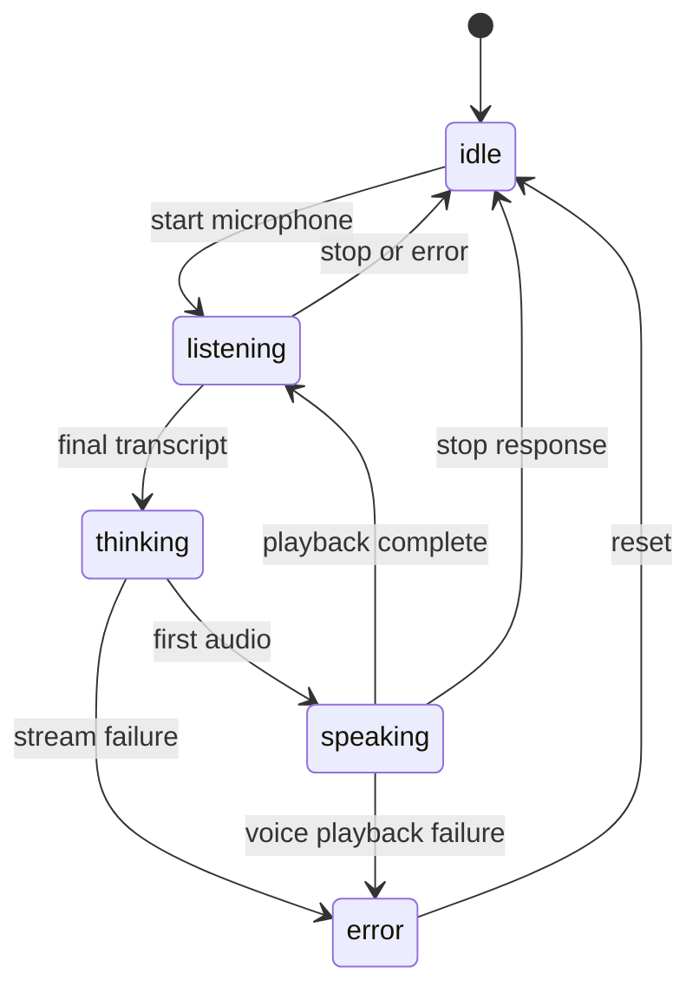

# 🎨 Frontend architecture

The client is deliberately dependency-free: [`static/index.html`](../static/index.html) defines the UI, [`static/styles.css`](../static/styles.css) styles it, and [`static/app.js`](../static/app.js) owns interaction and network state. The visible UI is an avatar/status surface rather than a transcript view.

## 🎛️ Controller responsibilities

`app.js` requests microphone permission, opens `/api/stt`, sends PCM frames, consumes cumulative/interim and final events, posts chat context, splits streamed text into speakable sentences, requests `/api/tts`, and queues audio playback. It also disables or mutes capture while the assistant speaks to avoid feedback. The stop button aborts the active response/playback; the microphone button starts or ends a listening turn.

Status text and `data-state`/`data-emotion` attributes drive CSS/avatar changes. The document exposes `role=status` and `role=alert`; reduced-motion rules are in CSS. The backend is the source of provider truth, so the UI should display returned error messages rather than inventing provider states.

Source: [`index.html`](../static/index.html), [`app.js`](../static/app.js), [`styles.css`](../static/styles.css).
