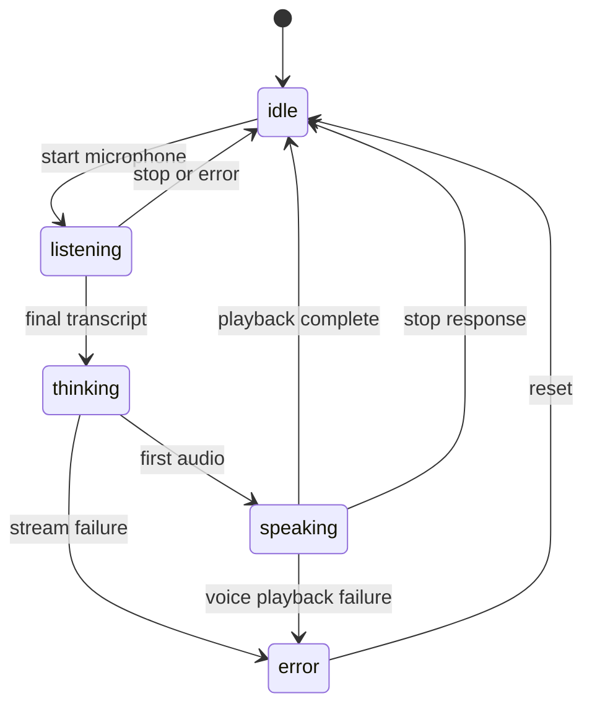

# 🎨 Frontend architecture

The client is deliberately dependency-free: [`static/index.html`](../static/index.html) defines the UI, [`static/styles.css`](../static/styles.css) styles it, and [`static/app.js`](../static/app.js) owns interaction and network state. The visible UI is an avatar/status surface rather than a transcript view: streamed reply text appears live in the status line, short progress and success lines stay on screen, and a How-to panel lists the mail/meeting steps on startup, and `action` stream events render as a tappable link line (Connect Google, new tab).

## 🎛️ Controller responsibilities

`app.js` requests microphone permission, opens `/api/stt`, sends PCM frames, consumes cumulative/interim and final events, posts chat context, splits streamed text into speakable sentences, requests `/api/tts`, and queues audio playback. The mic stays on across turns: after each finalized turn and each finished response it reopens automatically while listening is requested; tapping the mic button stops listening fully. The stop button aborts the active response/playback. A finished turn re-pumps the queue so a queued turn starts immediately instead of stacking, and only one audio source ever plays at a time. The spoken and on-screen greeting casts Raala as a receptionist for meetings, mail, and tasks. When idle, the mic still closes after each finalized turn. The stop button aborts the active response/playback; the microphone button toggles listening fully off. A microphone picker lists audio inputs (remembered across visits) with a live level bar, so a headset that is not the OS default input can be selected. One text box accepts a typed email address or Confirm for the same `enqueueTurn` pipeline; anything else is rejected inline with an error message. TTS prefetches one sentence ahead (cache of 4); server stage timings from the stream's `done` event feed the turn-latency log.

Status text and `data-state`/`data-emotion` attributes drive CSS/avatar changes. The document exposes `role=status` and `role=alert`; reduced-motion rules are in CSS. The backend is the source of provider truth, so the UI should display returned error messages rather than inventing provider states.

Source: [`index.html`](../static/index.html), [`app.js`](../static/app.js), [`styles.css`](../static/styles.css).
