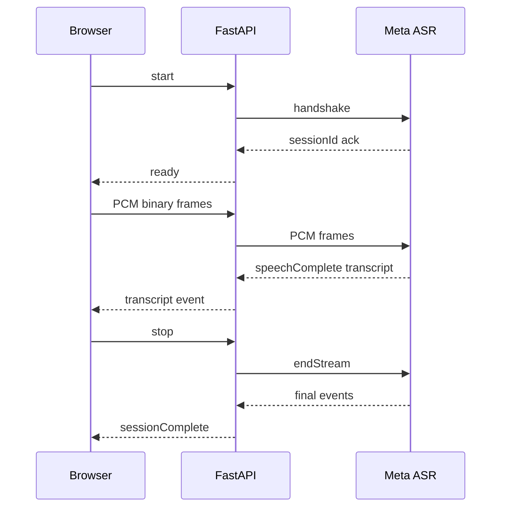

# 🗣️ Speech-to-text

`/api/stt` is a bidirectional WebSocket relay to `wss://api.meta.ai/v1/asr/realtime` using model `muse-voice-transcribe-1.0`. The browser must first send `{"type":"start"}`. The server accepts the client socket, checks `MODEL_API_KEY`, opens an upstream socket with a generated session ID, and sends this handshake:

```json
{"authorization":{"accessToken":"Bearer <server key>"},"audioEncoding":"PCM_24KHZ","model":"muse-voice-transcribe-1.0","mode":"ENDPOINTING","partialMode":"CUMULATIVE","languageBias":["English"],"emitAudioProgress":false}
```

After an upstream acknowledgement containing `sessionId`, the browser receives `ready`. Two tasks then run concurrently: one forwards browser audio/control messages and one forwards decoded upstream JSON. Provider `error` events are relayed, and normal end-of-stream produces `sessionComplete` followed by a close.



Timeouts cover the initial client message and upstream acknowledgement. The server logs exception types/session IDs, not credentials or audio. See [contracts](12-frontend-backend-communication-contracts.md).
