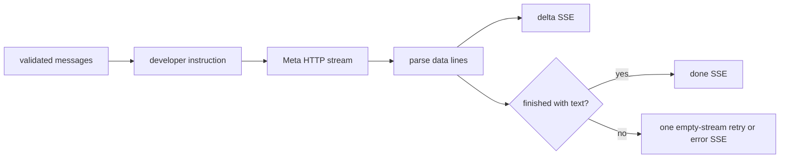

# 💬 LLM and response streaming

`POST /api/chat/stream` validates one to 40 `user`/`assistant` messages, each 1-8,000 characters, and rejects total context over 24,000 characters with 413. It prepends a developer instruction asking Muse Spark for concise spoken language without Markdown. The backend sends the request to `https://api.meta.ai/v1/chat/completions` with `stream: true`, model `CHAT_MODEL` (default `muse-spark-1.3`), and a bearer authorization header.

The response is normalized to SSE events: successful text becomes `data: {"type":"delta","text":"..."}`, completion becomes `{"type":"done"}`, and failures become `{"type":"error","message":"..."}`. The parser accepts `choices[0].delta.content`, message content, or legacy `choice.text`; empty successful streams are retried once. The shared `httpx.AsyncClient` is reused across turns.

Timeouts are connect 10s, read 45s, write 20s, pool 10s. Provider HTTP errors are reduced to a safe message (up to 500 characters); authorization is never included in an event. Source: `_stream_muse_chat` and `chat_stream` in [`app/main.py`](../app/main.py).
