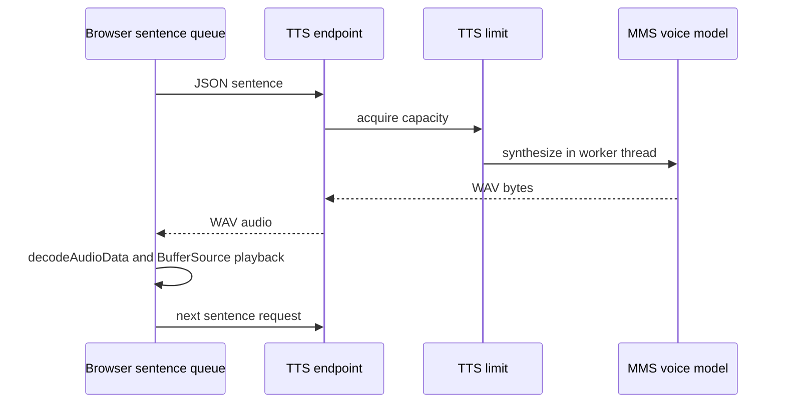

# 🔊 Text-to-speech and audio playback

The browser sends each completed sentence to `POST /api/tts`. The request permits `model: "mms"` and text from 1 through 1,000 characters. The endpoint calls [`synthesize_to_bytes`](../app/tts.py) in `asyncio.to_thread`, protected by the lifespan semaphore (two concurrent syntheses), and returns `audio/wav` with an attachment filename.

MMS model ID is `facebook/mms-tts-eng`. It is loaded once, on startup warm-up or first request, onto CUDA when available and otherwise CPU. Synthesis tokenizes each sentence, runs inference mode, inserts 0.15 seconds of silence between sentence waveforms, and writes PCM-16 WAV into `BytesIO`; it does not create a temporary audio file. The model uses configured speaking/noise parameters in `tts.py`.

The client serializes playback so sentences retain order and can be interrupted. A first-use model download/load can dominate latency; `/api/health` exposes `model_ready` for warm-up visibility. See [performance](15-performance-and-latency.md).
