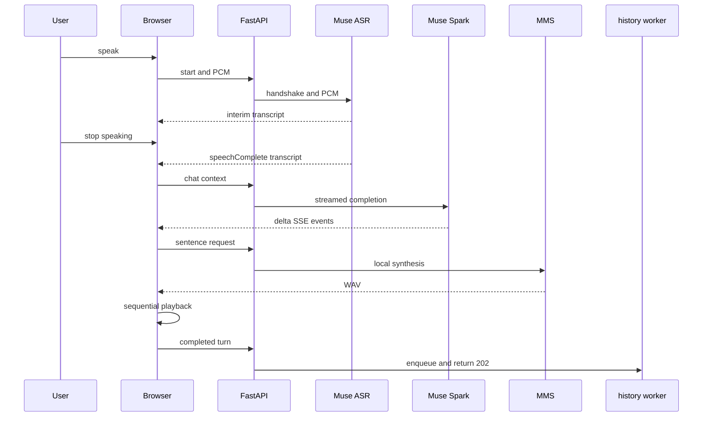

# 🔄 Complete conversation lifecycle

A turn crosses four streaming boundaries: browser capture, remote ASR, remote chat, and local TTS.

The frontend retains up to `MAX_CONTEXT_TURNS` (currently 3) completed turns for context, while the server enforces the 40-message and 24,000-character request limits. A generated turn is persisted only after assistant text is complete. Capture and the STT socket are stopped when speech is finalized, before the assistant starts thinking, and Stop response aborts active work so a new turn does not overlap old playback. Listening must be started explicitly for the next turn.

Startup clears previous log files, so history is per server run. `/api/history` is a disk snapshot and may briefly lag a just-enqueued turn; `POST /api/history/turn` is intentionally asynchronous. Agent turns (Calendar, Gmail, Tasks) add a gate between chat context and the streamed completion: selection, validated registry execution (or a confirmation proposal for writes), then a verbalized answer. A confirmed write executes only after the exact "confirm" reply and only against Google's live response.
