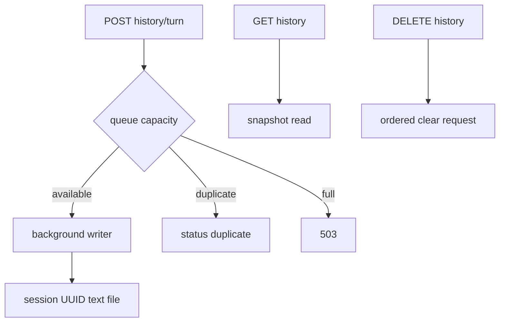

# 📝 Conversation history and persistence

[`ConversationLogWorker`](../app/conversation_logs.py) is an in-process bounded `asyncio.Queue` writer. Each item contains UUID session/turn IDs, user text, assistant text, and a UTC timestamp. `enqueue` uses `put_nowait`, returns `queued`, `duplicate`, or `full`, and never waits on disk I/O.

At worker start, existing markers are scanned so the `(session_id, turn_id)` pair remains idempotent across a worker restart. Writes append to `conversation_logs/session-<session hex>.txt` with a readable header and JSON-quoted User/Assistant fields. The writer task performs blocking filesystem work through `asyncio.to_thread`.

`GET /api/history` calls `list_turns_snapshot`, so it does not wait for queue drain. `list_turns` is the draining variant for tests/orderly operations. `DELETE /api/history` places a clear request in the same queue and waits until prior writes are ordered before deleting session files. Lifespan startup calls clear too.

Logs contain completed text only: no API keys, raw audio, interim STT, or provider tokens. Files are runtime data and ignored by Git. See [`conversation_logs.py`](../app/conversation_logs.py) and [privacy](16-security-and-privacy.md).
