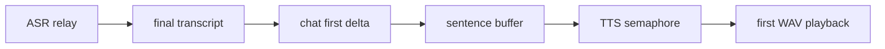

# ⚡ Performance and latency

The main latency-sensitive path is listening -> final transcript -> first chat delta -> first synthesized sentence. The implementation avoids unnecessary blocking in each stage.

- A shared `httpx.AsyncClient` reuses connections; limits are 10 keep-alive and 10 total connections.
- Chat timeouts are connect 10s, read 45s, write 20s, pool 10s.
- MMS warm-up starts in the background during lifespan, so first-turn work can happen before a response; failures retry lazily.
- TTS runs in a worker thread and is limited to two concurrent syntheses by an `asyncio.Semaphore`.
- TTS returns in-memory WAV bytes rather than writing temporary files.
- History enqueue uses `put_nowait`; GET uses a disk snapshot rather than `queue.join()`.
- Chat retries one empty successful provider stream, but does not retry arbitrary text or network failures.

The dominant variable costs are network/provider response time and first model download/inference, especially on CPU. Keep the 1,000-character TTS limit and 24,000-character chat context limit in mind when measuring. Do not trade away cancellation, bounded queues, or feedback suppression for speculative micro-optimizations.

## Measured budget (warm app, speak -> heard reply)

| Stage | Target | Notes |
|---|---|---|
| ASR relay to final transcript | provider-bound | Meta ENDPOINTING; mic auto-reopens after each turn until the mic button stops it |
| Bare mail/meeting intent to first delta | < 300 ms | fast-path skips the selector LLM call (`selector_ms: 0`) |
| Selector LLM call (complex intents) | provider-bound | capped at 256 completion tokens, JSON-only |
| First TTS sentence | model-bound | MMS warmed at startup; check `/api/health` `tts_device` (want `cuda`) |
| Sentence N+1 | overlaps N playback | browser prefetches one sentence ahead (cache of 4) |

Server stage timings (`selector_ms`, `tool_ms`, `verbalize_ms`, `exec_ms`) ride on the stream's final `done` event as `server_ms` and are printed by the client's turn-latency log. Only one audio source ever plays at a time, and a finished turn re-pumps the response queue.
