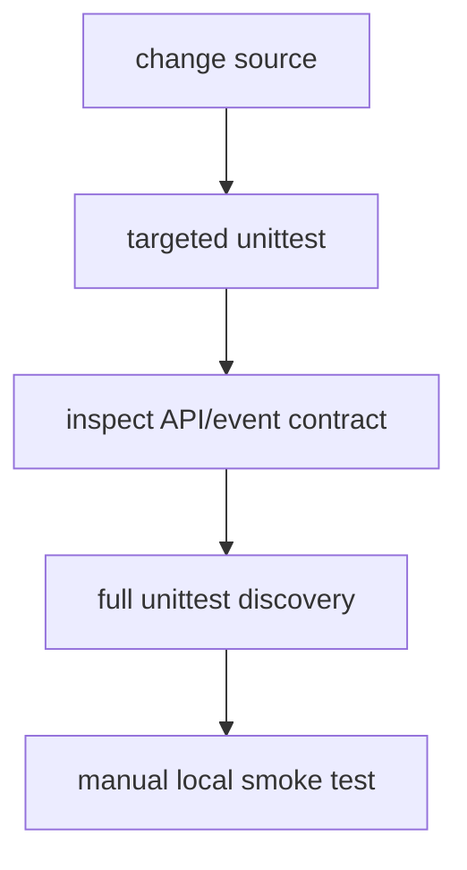

# 🛠️ Development and extension guide

Run from the repository root with Python 3.12 and the existing virtual environment. Make a focused change, run the relevant unittest module, then run the full discovery command before merging. Keep provider credentials out of patches.

## 🧱 Where to extend

- Add or change HTTP/WebSocket behavior in `app/main.py`, then update contract/API docs and tests.
- Change local voice behavior in `app/tts.py`; preserve `synthesize_to_bytes` and the semaphore boundary unless the API contract changes.
- Change persistence in `app/conversation_logs.py`; retain idempotency, bounded enqueue, snapshot reads, and orderly clear.
- Change interaction in `static/app.js` and keep UI states, cancellation, audio sequencing, and accessibility attributes coherent.
- If modularizing routes, explicitly call `app.include_router(...)` and reconcile duplicate decorators; currently extracted routers are inactive.

When adding a provider, isolate credentials in the backend, bound input/output, normalize errors, and add cancellation tests. When adding persistence, decide whether data survives restart and document it; this app currently clears logs at startup. Avoid broad refactors of the streaming path without tests for partial streams, empty streams, and cancellation.
