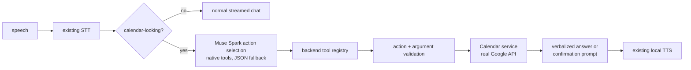

# 📅 Google Calendar agent tool (Raala's first tool)

Raala answers Calendar questions through the existing voice interface. There is
no Tools page or dashboard: the user speaks, the backend decides whether a
Calendar action is needed, runs it through a validated registry, and speaks the
result with the normal TTS pipeline.

Supported voice requests: today's meetings, upcoming meetings (bounded days),
availability checks, one event's details, and scheduling a meeting after an
explicit spoken confirmation. Deletion, modification, sharing, and arbitrary
Google API calls are not supported.

## Flow

The keyword prefilter means ordinary chat costs one LLM call, exactly as
before. Calendar reads cost one extra selection call plus the verbalization
stream; errors and confirmation prompts are deterministic strings (no extra
LLM call). Muse Spark never receives credentials or tokens.

## Actions (strict allow-list)

| Action | Kind | Arguments |
|---|---|---|
| `get_today_events` | read | none |
| `get_upcoming_events` | read | `days` 1-90 (default 7), `limit` 1-50 (default 10) |
| `check_calendar_availability` | read | `start`, `end` ISO datetimes; window max 31 days |
| `get_event_details` | read | `event_id` |
| `create_calendar_event` | write | `summary`, `start`, `end` ISO datetimes, optional `description`, `time_zone`; max 24h duration |

Anything else (delete, share, modify, Gmail/Tasks/Sheets) returns the
unsupported-action message. Unknown action names can never execute: only
registered names run.

## Confirmation workflow

`create_calendar_event` never runs unconfirmed:

1. The agent proposes the exact event (summary, local start/end) and asks for
   confirmation. The proposal is stored server-side, bound to the chat
   `session_id`, and expires after 5 minutes.
2. Short agreement ("Confirm", "Yes, send it") confirms only when it carries no new address, number, or date. Anything else is treated as new input.
3. If the confirmation message carries a *different* event, the pending
   proposal is discarded and the new request is handled instead.
4. The pending proposal is consumed (single-use) *before* the Google API call,
   so duplicates cannot create two events.
5. Success is claimed only after Google's create response arrives.
6. After Confirm, Raala first streams a progress line ("Scheduling your meeting now...") while the API call runs, then the success line. Both appear on screen and are spoken.

Read actions need no confirmation. `session_id` is optional in
`POST /api/chat/stream` and is sent by the current frontend for this purpose.

### Guided slot-filling

You do not need every detail in one breath. "Schedule a meeting" starts a per-session draft and Raala asks for just the title, then the start, then the end ("tomorrow at 10 AM", then "11" or "one hour"). A complete one-go request still jumps straight to confirmation. An end at or before the start is asked again instead of proposed.

## OAuth and token storage

Google Cloud app (web application): origin and redirect URI are both
`http://127.0.0.1:8002`, callback path `/auth/google/callback`. Calendar,
Gmail send, and Tasks scopes are requested together (see
[21 Gmail + Tasks tools](21-gmail-tasks-agent-tools.md)).

- `GET /auth/google/login` redirects to Google (offline access, consent).
  503 when not configured. Single-use, 10-minute `state` tokens prevent CSRF.
- `GET /auth/google/callback` validates state, exchanges the code, stores the
  refresh token, and shows a plain success page. Failures are structured
  400/502 errors; no tokens reach the browser.
- `GET /api/google/status` returns `{connected, configured}` (no token data).
- `POST /api/google/disconnect` deletes the stored token.

When Google is configured but no account is linked yet, Raala says so
herself: on the first tool-related turn, the chat gate checks the connection
before the selection call and slot-filling, speaks a short prompt, and sends
an `action` event carrying the login URL, which the UI renders as a
tappable "Connect Google" link (new tab). The URL is never spelled aloud.
Bare "meetings today" reads skip the selector LLM call entirely
(`selector_ms: 0` in the stream's server timings). If Google refuses consent (`access_denied`), the
callback shows a guidance page explaining that the developer must add the
user's Gmail address under Test users before retrying login. The consent
click itself stays manual (phishing safety) — everything around it is
automatic.

Refresh tokens live in `secrets/google_tokens.json` (gitignored) with
best-effort 0600 permissions. Access tokens are cached in memory and refreshed
on 401 (one retry). A revoked/expired grant clears the stored token and tells
the user to reconnect. Times are interpreted in the server's local timezone,
never silently as UTC.

## Errors

Structured codes: `not_connected`, `auth_expired`, `rate_limited`,
`network_error`, `provider_error`, `invalid_arguments`, `invalid_request`,
`unsupported_action`, `needs_confirmation`. Spoken messages are user-safe;
tokens and raw provider bodies are never logged or stored in history.

## Adding Gmail, Tasks, or Sheets later

1. Add `app/integrations/google/<service>.py` with pure API functions plus a
   `register_<service>_tools(registry, deps)` function.
2. Register it where the Calendar tools are registered; no voice-pipeline or
   chat-flow changes needed.
3. Add action models to `app/agent/action_models.py` and tests mirroring
   `tests/test_agent_calendar.py`.
4. Document the new actions on this page.

Gmail and Tasks are now implemented; see [21 Gmail + Tasks tools](21-gmail-tasks-agent-tools.md).
Do not add empty or dummy registrations. Each service owns its actions,
validation, permission checks, and tests.

## Meeting-only scheduler (current behavior)

Raala is a meeting scheduler. The voice intro, on-screen hints, and the chat
developer prompt present meetings only.

- Saying "schedule a meeting" (or "book", "set up", "arrange", "here to
  schedule a meeting") skips the selector LLM call. One Google range read for
  tomorrow 9:00 AM-7:00 PM computes the 10 hourly slots; only free slots are
  spoken and rendered.
- The spoken availability line names the count, exact date, and timezone
  only, for example "Tomorrow, Friday, 2026-11-06, I found 10 open times in
  India Standard Time. They are shown on your screen. Which time works for
  you?" The full times stay on the clickable slot cards; reading them aloud
  sounds robotic through TTS. Fully-booked days say so and offer the next
  date.
- A short spoken brief follows (one-hour duration, 9 AM-7 PM window, topic,
  video/phone/in-person types, name + email + time needed), then `meeting_slots`
  and `meeting_form` action events. Slot buttons can be clicked or spoken;
  clicking also fills the form's time and sends the voice turn.
- The meeting form appears with a fade/slide/scale animation only at that
  point and vanishes on booking or cancel, returning the page to its
  single-column layout. While the form is open the page uses a two-column
  split: the agent stays sticky on the left half while the slots and form sit
  on the right half (single column on narrow screens). The slots and form
  stay on screen while voice questions are answered and hide only on booking,
  cancel, confirmation, or a fresh availability offer. The form's Cancel
  button clears the form, drops the flow, and returns to chat mode for a
  fresh start. It collects full name, email,
  optional phone, meeting time (changeable), timezone, topic, meeting type,
  and notes; voice, keyboard, and mouse all work, and invalid entries get a
  polite spoken-style message.
- "What slots are free?" questions get a live availability answer only: a
  short spoken check plus the clickable slot cards, never the form, in voice
  and chat mode alike. Tapping or saying a time verifies it against live data
  and opens the form with that time prefilled, only when free. A request that
  names its own time ("book 10 AM tomorrow") is verified the same way: a
  taken time gets "That time is not available" plus alternatives and no form.
  The same guard applies mid-conversation: a taken time is never stored as a
  topic answer and never triggers any form action.
- The form is the default input. Picking a slot card (or saying the time)
  gets a short "Got it: [date] at [time] [timezone]" and points at the form;
  voice never interrogates field by field. Anything said by voice is
  harvested (topic, type, name, email, time changes — several details in one
  message all land) and mirrored into the form via the `meeting_form`
  action's `prefill`, without overwriting typed content; the reply names only
  what is still missing from the form. If no email was given, the testing
  address (`pixelssunny@gmail.com`) is used and disclosed, never silently
  replacing a supplied address. When everything is known, Raala reads the
  exact summary ("Please confirm: a [type] about [topic] on [date] at [time]
  in [timezone], under [name], using [email]. Should I book it?") and calls
  the booking core only after an explicit spoken yes/confirm/go-ahead (there
  are no on-screen Confirm/Decline buttons; the filled form's Book button and
  the spoken confirmation are the two confirmations). "I want to fill the form" restores the form
  with known values instead of restarting. A taken slot offers up to three
  spoken alternatives instead. "Did you schedule the meeting?" answers from
  live state: booked reports date/time/ID, otherwise it says what is still
  missing — never the availability list again.
- Booking requires a connected Google account: without one, both voice and
  form booking stop with "Your Google account is not connected yet. Please
  connect Google, then ask me to book it again." (plus a tappable Connect
  Google link in voice) instead of a local-only record. Success is claimed
  only after the Calendar event is created, with the booking ID.
- `POST /api/meetings/book` is the form's confirmation (no extra Confirm
  step): it sanitizes input, rechecks the slot against live Calendar data to
  stop double-booking (409 when just taken), creates the Calendar event only
  when the slot is still free (422 when Google is not connected), mints a
  unique booking ID, appends one JSON row to `bookings.jsonl`, and attempts
  the optional Google Sheet. The voice flow shares this same core
  (`_create_meeting_booking`).
- Sheets is env-only (`GOOGLE_SHEETS_SPREADSHEET_ID`, `GOOGLE_SHEETS_SHEET_NAME`,
  `GOOGLE_SERVICE_ACCOUNT_JSON` or `GOOGLE_SHEETS_CREDENTIALS_FILE`). When
  missing or failing, the booking row is kept locally, the failure is logged
  server-side with booking ID + reason (never to the user), and the status is
  marked for administrative follow-up. The visitor still hears the booking
  confirmation because the appointment itself succeeded.
- The confirmation mail uses the `confirmation_html` template in
  `app/agent/meetings.py` (header, booking-details table, booking ID, inline
  CSS, HTML-escaped fields) with a plain-text fallback, sent as multipart via
  Gmail in the background after booking. It never blocks the spoken reply:
  the reply says "Setting that up now: you will get confirmation once it is
  ready" while mail + sheet writes finish. Every booking response also
  carries `calendar`, `mail`, and `sheets` flags. The on-screen status bar
  shows them as three icons flowing right to left — Slot, Save, Done — that
  light up one after another: hovering an icon reveals its status, clicking
  it shows the short message (including the booking ID and any sheet
  follow-up note). Calendar here is the Google Calendar events API (no Meet
  links are created).
- Booking means a real Calendar event: the core rechecks the slot and calls
  `create_event`, and only a successful create is confirmed, recorded, and
  mailed. No event, no success claim — ever. Slots already in the internal
  `bookings.jsonl` log count as busy too, so booked times stay blocked even
  without a live Calendar connection.
- While a form booking runs, the agent first stops any playing audio, then
  speaks the filled details aloud ("Booking your video call about ...")
  in parallel with the background work, and scrolls the status bar and the
  final confirmation into view — no scrolling needed to find them.
- The `/dashboard` page lists every internal booking (newest first) with its
  date, time, topic, type, contact, booking ID, and status flags, plus the
  Google Sheet link when Sheets is configured (`GET /api/meetings/bookings`,
  `GET /api/meetings/sheets-link`). Reach it from the Meetings link in the
  top bar. Each booking card has a Cancel button (with a confirm step) that
  deletes the Calendar event and marks the record cancelled, freeing the slot
  immediately; cancelled rows stay visible as "Cancelled — slot freed." If
  the Calendar delete fails (for example Google is not connected), the exact
  reason is shown and the event must be removed in Google Calendar, otherwise
  that slot stays blocked there. "Clear cancelled" purges cancelled rows
  from the local log (`DELETE /api/meetings/bookings?only=cancelled`).
- A Start button gates the first run: it warms audio, preloads the spoken
  intro ("I am Raala, your receptionist..."), warms the availability lookup,
  then plays the intro automatically. The microphone keeps its tap-to-talk
  behavior afterwards.
- `GET /api/meetings/availability?date=YYYY-MM-DD` returns the 10 slots with
  live `available` flags for the form and slot cards.
- Chat mode: typing in the message box (marked Chat mode) opens a chat thread
  next to the face — half the screen each — with user and assistant bubbles
  streaming live, plus a "thinking" indicator while Raala works. Opening chat
  closes the form; in chat mode details are collected by asking one question
  at a time in the thread (topic, type, name, email), never by form. Voice
  turns also appear there once chat is open; pure-voice use stays
  transcript-free and keeps the form-first flow.
- Pure logic lives in [`app/agent/meetings.py`](../app/agent/meetings.py);
  Sheets stub in [`app/integrations/google/sheets.py`](../app/integrations/google/sheets.py);
  chat fast-path, availability, and booking routes in [`app/main.py`](../app/main.py).

Source: [`app/agent/`](../app/agent/), [`app/integrations/google/`](../app/integrations/google/),
chat gate and auth routes in [`app/main.py`](../app/main.py), tests in
[`tests/test_agent_calendar.py`](../tests/test_agent_calendar.py).
